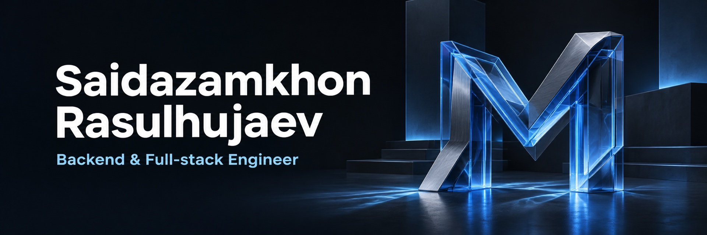

**Founder of MONO Club · Backend & full-stack engineer · Tashkent, Uzbekistan**

[**View CV ↗**](./Saidazamkhon_Rasulhujaev_CV.pdf) · [Download PDF](./Saidazamkhon_Rasulhujaev_CV.pdf?raw=1) · [**MONO Club ↗**](https://club.mono-games.uz/)

## Selected work

### MONO Club
**Founder & Lead Engineer** · Software for PC gaming clubs

I built the software that runs the club floor, from the front desk to the player's PC.

- **Staff dashboard** — reservations, cash desk workflows, club-specific wallets and VIP pricing.
- **Billing backend** — time purchases, extensions and refunds tied to server-side session state. Migrated existing wallet and session history to club-scoped accounts and verified tenant isolation against PostgreSQL.
- **Player experience** — QR sign-in and game launch through a Windows launcher and workstation agent, plus an Expo companion app and its NestJS social service.

`C#` `ASP.NET Core` `PostgreSQL` `Windows` `React Native` `Docker`

### MONO Games
**Creator & Full-stack Developer** · Browser gaming platform

Built and launched a platform for playing and creating browser games, with AI-assisted creation, community features and leaderboards. I built the Vue frontend, NestJS API and a PostgreSQL-backed generation pipeline with automated browser validation, retries and deployment.

`TypeScript` `Vue` `NestJS` `PostgreSQL` `Prisma` `Playwright`

## Professional experience

### Akfa AI Lab · Backend Developer
*Sep 2024 – Present*

- Develop and maintain **AKFA UMS**, the backend for university admissions, student records, billing and reporting. Build NestJS APIs, model relational data and optimize PostgreSQL queries.
- Build **1C, Bitrix24 and payment integrations**, including billing workflows and payment-status callbacks across systems.
- Build the **GEM gamification backend** for achievements, streaks, leaderboards and a rewards marketplace, with Redis and Bull handling background jobs.

### Citifuel · Frontend Developer
*May 2024 – Nov 2025*

- Built **React and TypeScript dashboards** for fuel-network and logistics operations, combining maps, filters, charts and tables for station, company and customer reporting.
- Integrated REST APIs and built reusable CRM components using TanStack Query, Zustand, React Hook Form and Zod.
